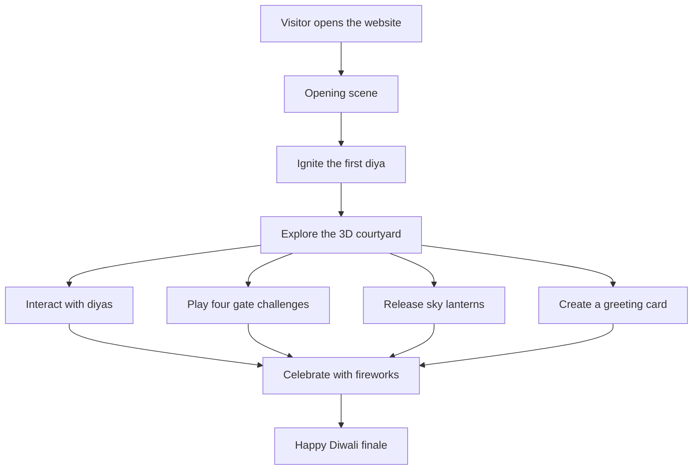
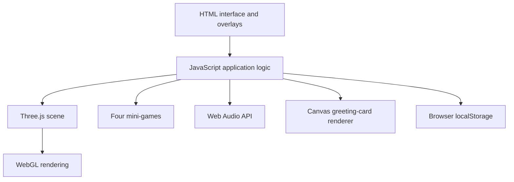

<div align="center">

# 🪔 The Grand Diwali Celebration

### The Courtyard of Light — an immersive, interactive 3D Diwali experience

**Light the diyas. Awaken the gates. Release sky lanterns. Celebrate under a sky of fireworks.**

<br/>

[](https://keshav-jora.github.io/diwali-3d-celebration/)
[](https://github.com/Keshav-Jora/diwali-3d-celebration)
[](https://threejs.org/)
[](https://developer.mozilla.org/en-US/docs/Web/JavaScript)

**A browser-based celebration of light, interaction, and festive atmosphere.**

<br/>

<a href="https://keshav-jora.github.io/diwali-3d-celebration/"><strong>✦ OPEN THE LIVE EXPERIENCE ✦</strong></a>

</div>

---

## ✨ About the Project

**The Grand Diwali Celebration** is an interactive 3D web experience inspired by the atmosphere of a traditional Diwali courtyard. Visitors begin by igniting a diya, explore the festive environment, interact with lights, complete four gate challenges, release glowing sky lanterns, create a personalized greeting, and trigger a fireworks celebration.

The project is built with HTML, CSS, JavaScript, and Three.js. It runs as a static website without a project-specific backend or build step.

> **Project type:** creative frontend / WebGL prototype. The courtyard is assembled with procedural 3D elements. This is an interactive browser experience, not a photorealistic simulation or a commercial-grade 3D game.

## 🎬 Live Demo

<div align="center">

### [🪔 TRY THE GRAND DIWALI CELEBRATION](https://keshav-jora.github.io/diwali-3d-celebration/)

Explore the courtyard directly in your browser.

</div>

**Repository:** [Keshav-Jora/diwali-3d-celebration](https://github.com/Keshav-Jora/diwali-3d-celebration)

## 🌟 Features

### 🏛️ Interactive 3D courtyard
- A festive night-time environment created with Three.js.
- Traditional-inspired architectural details, warm lighting, diyas, and decorative rangoli.
- Interactive camera controls for exploring the scene.
- An opening sequence that begins when the visitor ignites the first diya.

### 🪔 Diya interactions
- Click or tap individual diyas to interact with the lights.
- Bring more light into the courtyard as you explore.

### 🎆 Fireworks celebration
- Trigger a multi-burst fireworks sequence.
- Particle-based visual effects and ground fountains.
- Browser-generated celebration sound effects.

### 🏮 Sky lantern release
- Release a group of glowing lanterns.
- Watch them rise and drift through the night scene.

### 🗝️ Four gate challenges

Complete the courtyard challenges to awaken the gates:

| Challenge | How it works |
|---|---|
| **Diya Memory** | Watch a sequence of glowing diyas, then repeat it. |
| **Rhythm Gate** | Tap the target when its glow reaches the timing ring. |
| **Mithai Match** | Reveal tiles and find all matching pairs. |
| **Path of Light** | Light the five diyas in the required order. |

Gate progress is stored in the browser's local storage on the same device and browser. It does not synchronize between devices.

### 💌 Personalized greeting studio
- Enter a name for a personalized Diwali greeting.
- Preview the greeting card.
- Download the generated card as a PNG image.

### 🎛️ Camera and display controls
- Rotate and zoom around the scene.
- Reset the camera view.
- Use fullscreen mode.
- Capture a screenshot of the rendered canvas.

### 🔊 Sound
- Firework and celebration effects are synthesized in the browser using the Web Audio API.
- A sound toggle controls the experience's audio.
- An optional externally hosted TV-show meme clip may be available; it is not bundled with this repository and is not required for the core experience.

## 🕹️ Controls

| Action | Desktop | Mobile / Touch |
|---|---|---|
| Start the experience | Click **Ignite the First Diya** | Tap **Ignite the First Diya** |
| Rotate the view | Click and drag | Drag with one finger |
| Zoom | Mouse wheel / on-screen controls | Pinch / on-screen controls |
| Interact with objects | Click | Tap |
| Open a feature | Click its button | Tap its button |
| Trigger fireworks | Click **Celebrate** | Tap **Celebrate** |
| Release lanterns | Click **Lanterns** | Tap **Lanterns** |
| Open greeting studio | Click **Greeting** | Tap **Greeting** |
| Toggle sound | Click **Sound** | Tap **Sound** |

**Audio note:** Modern browsers may require a direct user interaction before audio can play. Check device media volume and browser permissions if sound is unavailable.

## 🧱 Technology Stack

| Technology | Purpose |
|---|---|
| HTML5 | Page structure, controls, and overlays |
| CSS3 | Layout, visual styling, and responsive presentation |
| JavaScript (ES modules) | Application logic, interactions, mini-games, and animation |
| Three.js | 3D scene, geometry, materials, lighting, camera, and particle effects |
| Web Audio API | Synthesized firework and celebration sound effects |
| Canvas 2D API | Rendering and exporting the personalized greeting card |
| `localStorage` | Saving gate progress in the current browser |
| Google Fonts | Cinzel and DM Sans typography |

## 🧠 How It Works

The current release keeps the application in one HTML file. That file contains the page structure, styling, and JavaScript that creates the 3D scene and controls the interactions.



### Main browser components



### Implementation decisions
- **No build step:** the current version is intentionally kept in a single `index.html` file for straightforward hosting and inspection.
- **Procedural 3D scene:** courtyard elements are assembled with Three.js geometry and materials rather than a collection of external 3D models.
- **Browser-native audio:** synthesized sound effects avoid requiring separate sound-effect files.
- **Local progress:** gate progression is stored locally without requiring a user account or backend.

## 🚀 Run Locally

### Requirements
- A modern browser with WebGL support.
- An internet connection to load Three.js and Google Fonts from their CDNs.
- Python 3 (recommended) or another local static web server.

### Option 1 — Python

1. Clone or download this repository.
2. Open a terminal in the folder containing `index.html`.
3. Run:

```bash
python -m http.server 8000
```

If your system uses `python3`:

```bash
python3 -m http.server 8000
```

4. Open this address in your browser:

```text
http://localhost:8000
```

5. Keep the terminal running while testing. Press `Ctrl + C` to stop the server.

### Option 2 — VS Code Live Server

1. Open the repository folder in Visual Studio Code.
2. Install the **Live Server** extension if needed.
3. Right-click `index.html`.
4. Select **Open with Live Server**.

> Avoid relying on a direct `file://` open. A local HTTP server is more reliable for browser modules and web assets.

## 🌍 Deployment — GitHub Pages

This repository is configured for static hosting through GitHub Pages. The current version does not require npm, a build command, or a `dist` folder.

### Deployment settings

In the GitHub repository:

1. Open **Settings**.
2. Select **Pages**.
3. Under **Build and deployment**, choose **Deploy from a branch**.
4. Select branch `main`.
5. Select folder `/(root)`.
6. Save the settings.

The `index.html` file must remain in the repository root.

### Live website

**[https://keshav-jora.github.io/diwali-3d-celebration/](https://keshav-jora.github.io/diwali-3d-celebration/)**

For deployment status, open the repository's [Actions tab](https://github.com/Keshav-Jora/diwali-3d-celebration/actions).

Official guide: [GitHub Pages quickstart](https://docs.github.com/en/pages/quickstart).

## 📁 Repository Structure

```text
diwali-3d-celebration/
├── index.html        # Complete interactive experience
├── README.md         # Project overview and documentation
├── CONTRIBUTING.md   # Contribution guidelines
└── SECURITY.md       # Security and reporting guidance
```

The current application is intentionally compact. A future refactor could separate scene creation, games, audio, and greeting-card logic into dedicated modules.

## 🔐 Privacy and Data

- The current project does not require login or a project-specific backend.
- Gate progress is stored in the visitor's browser using local storage.
- Gate progress is not synchronized between devices or browsers.
- Greeting cards are generated in the browser and downloaded locally.
- The project loads third-party resources, including Three.js and Google Fonts, from CDNs.
- The optional externally hosted clip may cause a normal network request to its hosting provider.
- Never add passwords, API keys, personal tokens, or private credentials to this public repository.

## ⚠️ Known Limitations

- **Device performance:** WebGL performance varies by phone, GPU, browser, and available memory. Older devices may experience lower frame rates.
- **External dependencies:** Three.js and fonts require network access. CDN availability is outside this project's control.
- **Audio permissions:** browsers may block audio until the visitor interacts with the page.
- **Optional external clip:** the meme clip may fail if its host blocks embedding, changes the URL, or removes the media. It is not required for the core experience.
- **Local-only progress:** saved gate progress does not follow the visitor to another browser or device.
- **Testing scope:** source and packaging checks have been performed, but the project has not been exhaustively tested on every browser, phone, or screen size.

## 🧪 Testing Checklist

Before publishing a change, test the following:

- [ ] Opening screen appears and the first diya can be ignited.
- [ ] 3D courtyard renders without a blank screen.
- [ ] Camera drag and zoom work.
- [ ] Individual diyas respond to interaction.
- [ ] Diya Memory challenge works.
- [ ] Rhythm Gate challenge works.
- [ ] Mithai Match challenge works.
- [ ] Path of Light challenge works.
- [ ] Gate progress persists after a page refresh.
- [ ] Reset clears saved gate progress.
- [ ] Celebrate triggers fireworks and sound when audio is enabled.
- [ ] Lanterns rise and disappear as expected.
- [ ] Greeting card downloads as a PNG.
- [ ] Screenshot and fullscreen controls work.
- [ ] Sound can be turned on and off.
- [ ] Layout is usable on a narrow mobile screen.

## 🧯 Troubleshooting

| Problem | What to check |
|---|---|
| Blank or dark screen | Confirm WebGL is enabled; reload and check the browser console. |
| 3D scene does not load | Check internet access and whether the Three.js CDN is reachable. |
| No sound | Tap the sound control, check media volume, and verify browser audio permissions. |
| Optional clip does not play | The clip is third-party hosted and may be unavailable. The core experience does not depend on it. |
| Slow animation | Close other heavy tabs or apps and try a newer device/browser. |
| Progress did not transfer | Progress is stored locally and does not sync between devices or browsers. |

When reporting a bug, include your device, operating system, browser/version, steps to reproduce, expected result, actual result, and a screenshot or recording if possible. Never include passwords, private tokens, or personal data.

## 🗺️ Roadmap

Potential improvements for future versions:

- [ ] Split the single HTML file into maintainable modules.
- [ ] Add optimized 3D models and richer physically based materials.
- [ ] Add adjustable graphics quality for lower-powered mobile devices.
- [ ] Improve keyboard navigation and screen-reader labels.
- [ ] Add reduced-motion preferences.
- [ ] Add automated smoke tests and real-device performance checks.
- [ ] Replace or remove externally hosted media with properly licensed assets.
- [ ] Add a dedicated credits and asset-attribution page.

## 🤝 Contributing

Suggestions, improvements, and reproducible bug reports are welcome.

1. Fork the repository.
2. Create a branch for your change.
3. Make a focused improvement.
4. Test the relevant interactions.
5. Open a pull request explaining what changed and how you tested it.

For larger changes, open an issue first to discuss the proposed approach. See [CONTRIBUTING.md](CONTRIBUTING.md) for contribution guidance.

## 📚 Credits and Third-Party Resources

- [Three.js](https://threejs.org/) — 3D rendering library.
- [Google Fonts](https://fonts.google.com/) — Cinzel and DM Sans.
- [GitHub Pages](https://pages.github.com/) — static hosting.

Third-party libraries, fonts, and externally hosted media remain subject to their respective licenses and terms. The optional TV-show meme clip is not owned by this project. Verify that you have permission to use or publicly distribute third-party media; remove the optional clip if you cannot verify those rights.

## 📄 License

**No license file is currently included.** Until a license is selected and added to the repository, visitors should not assume they have permission to reuse, modify, or redistribute the source code.

If you intend to publish this as an open-source project, choose a license that fits your goals and add its complete text in a file named `LICENSE`. Do not label the project as MIT-licensed until that file is present.

---

<div align="center">

**Built with code, curiosity, and the spirit of Diwali.** 🪔

### [✦ Visit the Live Demo](https://keshav-jora.github.io/diwali-3d-celebration/)

[View Source on GitHub](https://github.com/Keshav-Jora/diwali-3d-celebration)

</div>
