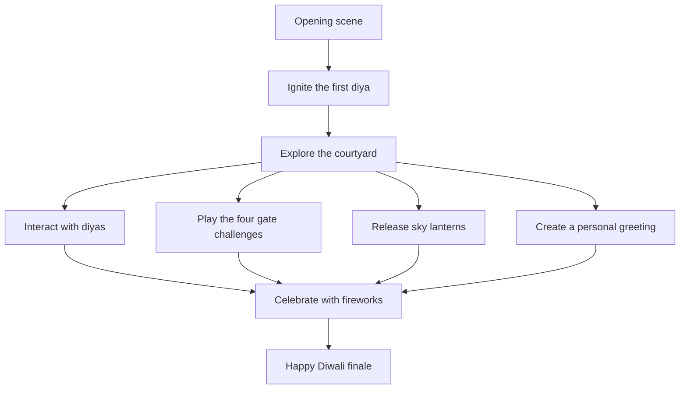
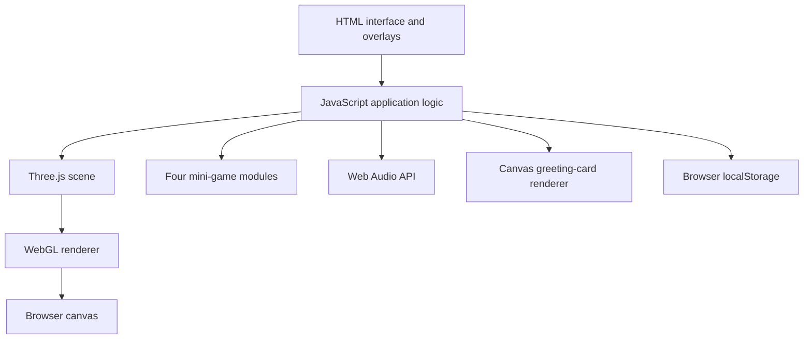

<div align="center">

# 🪔 The Grand Diwali Celebration

### The Courtyard of Light — an immersive, interactive 3D Diwali experience

**Light the diyas. Awaken the gates. Release sky lanterns. Celebrate under a sky of fireworks.**

<br/>


**A browser-based celebration of light, interaction, and festive atmosphere.**

[Run locally](#-run-locally) · [Deploy](#-deploy-to-github-pages) · [Controls](#-controls) · [Report a bug](#-troubleshooting--bug-reports)

</div>

---

## ✨ Experience overview

**The Grand Diwali Celebration** is a small interactive 3D world inspired by the atmosphere of a traditional Diwali courtyard. The visitor begins by igniting a diya, then explores the environment, interacts with festive objects, completes four gate challenges, releases glowing lanterns, and triggers a fireworks celebration.

The experience is built as a lightweight, no-build-step web project. The 3D scene and animation are powered by Three.js; browser-native APIs handle sound effects and the downloadable greeting card.

> **Project type:** creative frontend / WebGL prototype. The environment is procedurally assembled in code. It is not a photorealistic game or a commercial-grade 3D production.

## 🎬 The visitor journey



## 🌟 Features

### The 3D courtyard
- A night-time courtyard built from procedural Three.js geometry.
- Traditional architectural details, warm lighting, decorative rangoli, and diya arrangements.
- A perspective camera with interactive orbit and zoom controls.
- An opening sequence that begins when the visitor ignites the first diya.

### Interactive celebration
- Click or tap individual diyas to interact with the lights.
- Trigger a multi-burst fireworks sequence with particle effects.
- Release a group of animated sky lanterns that rise and drift through the scene.
- Use the view controls to reset the camera.
- Enter fullscreen and capture a screenshot of the canvas.

### Four gate challenges
Complete the courtyard challenges to awaken the gates:

| Gate challenge | What to do |
|---|---|
| **Diya Memory** | Watch a sequence of glowing diyas, then repeat it. |
| **Rhythm Gate** | Tap the target when its glow reaches the timing ring. |
| **Mithai Match** | Reveal tiles and find all matching pairs. |
| **Path of Light** | Light the five diyas in the required order. |

Gate progress is saved in the browser's local storage on the same device and browser. It is not synced between devices.

### Personal greeting studio
- Enter a name for a personalized Diwali greeting.
- Preview the greeting card.
- Download the card as a PNG image.

### Sound
- Firework and celebration effects are synthesized in the browser with the Web Audio API.
- A sound toggle controls the experience's audio.
- The optional TV-show meme clip is fetched from a third-party host; it is not bundled with this repository and may not always be available.

## 🕹️ Controls

| Action | Desktop | Touchscreen |
|---|---|---|
| Start the experience | Click **Ignite the First Diya** | Tap **Ignite the First Diya** |
| Rotate the view | Drag the scene | Drag with one finger |
| Zoom | Mouse wheel / on-screen controls | Pinch / on-screen controls |
| Interact with a diya or button | Click | Tap |
| Start fireworks | Click **Celebrate** | Tap **Celebrate** |
| Release lanterns | Click **Lanterns** | Tap **Lanterns** |
| Open greeting studio | Click **Greeting** | Tap **Greeting** |
| Toggle audio | Click **Sound** | Tap **Sound** |

Audio playback may require a direct user interaction because of browser autoplay policies.

## 🧱 Technology and implementation

| Technology | Role in this project |
|---|---|
| HTML5 | Page structure, controls, and overlays |
| CSS3 | Layout, visual styling, responsive presentation, and interface states |
| JavaScript (ES modules) | Scene setup, application logic, interactions, mini-games, and animation |
| Three.js | 3D scene graph, geometry, materials, lights, camera, and particle effects |
| Web Audio API | Synthesized sound effects |
| Canvas 2D API | Rendering and exporting the personalized greeting card |
| `localStorage` | Saving gate progress in the current browser |
| Google Fonts | Cinzel and DM Sans typography |

### High-level architecture



### Design decisions
- **No build step:** the current version is intentionally kept in a single `index.html` file for straightforward hosting and inspection.
- **Procedural scene:** much of the courtyard is created from Three.js geometry and materials rather than downloaded 3D models.
- **Browser-native audio:** synthesized effects avoid requiring separate sound-effect files.
- **Local progress:** gate progression is stored locally, keeping the prototype independent of a backend or user account.

## 🚀 Run locally

### Requirements
- A modern browser with WebGL support.
- An internet connection to load Three.js and Google Fonts from their CDNs.
- Python 3 (recommended) or another static local web server.

### Option A — Python (no project installation)

1. Download or clone this repository.
2. Open a terminal in the project folder (the folder containing `index.html`).
3. Run:

```bash
python -m http.server 8000
```

If your system uses `python3`:

```bash
python3 -m http.server 8000
```

4. Open `http://localhost:8000` in your browser.
5. Keep the terminal running while testing. Press `Ctrl + C` to stop the server.

### Option B — VS Code

1. Open the project folder in VS Code.
2. Install the **Live Server** extension if you do not already have it.
3. Right-click `index.html`.
4. Select **Open with Live Server**.

> Avoid relying on a direct `file://` open. A local HTTP server is more reliable for browser modules and web assets.

## 🌍 Deploy to GitHub Pages

This project can be hosted as a static site. No Node.js build or `dist` folder is required for the current edition.

### 1. Create the repository
1. Sign in to [GitHub](https://github.com/).
2. Create a new repository named `diwali-3d-celebration`.
3. Choose **Public** if you want anyone to view the source.
4. Do not initialize another README if you are uploading this project's files.

### 2. Upload the files
Upload `index.html` and `README.md` to the repository's **root** directory, then commit the changes to the `main` branch.

The root should look like this:

```text
diwali-3d-celebration/
├── index.html
└── README.md
```

### 3. Enable GitHub Pages
1. Open the repository's **Settings**.
2. Select **Pages**.
3. Under **Build and deployment**, choose **Deploy from a branch**.
4. Choose branch `main` and folder `/(root)`.
5. Click **Save**.
6. Wait for GitHub Pages to finish publishing.

The public URL will follow this pattern:

```text
https://YOUR-GITHUB-USERNAME.github.io/diwali-3d-celebration/
```

Replace `YOUR-GITHUB-USERNAME` with your GitHub username. The first deployment may take several minutes.

Official guide: [GitHub Pages quickstart](https://docs.github.com/en/pages/quickstart).

### 4. Verify the live site
- Open the published URL in a private/incognito tab.
- Test the opening interaction and camera.
- Test all four mini-games.
- Test fireworks, lanterns, greeting-card download, and sound.
- Check the page on both a phone and a desktop browser.

## 📁 Repository structure

```text
diwali-3d-celebration/
├── index.html       # Complete experience: markup, styles, and JavaScript
└── README.md        # Project documentation
```

The current release is intentionally compact. If the project grows, a sensible next refactor would be:

```text
src/
├── main.js
├── scene/
│   ├── createScene.js
│   ├── courtyard.js
│   └── fireworks.js
├── games/
│   ├── memory.js
│   ├── rhythm.js
│   ├── matching.js
│   └── pathOfLight.js
├── audio/
└── greeting/
assets/
├── images/
└── audio/
```

This is a **future refactoring proposal**, not the current repository structure.

## 🔐 Privacy and data

- The current project does not require a login or project-specific backend.
- Gate progress is stored in the browser's local storage on the visitor's device.
- The greeting card is generated in the browser and downloaded locally.
- The project loads third-party resources such as Three.js and Google Fonts from CDNs.
- The optional meme clip is requested from an external host. That host may receive normal network request information.
- Do not add API keys, passwords, personal tokens, or private credentials to this public repository.

## ⚠️ Known limitations

- **Device performance:** WebGL performance varies by phone, GPU, browser, and available memory. Older devices may show lower frame rates.
- **External dependencies:** Three.js and fonts require network access. CDN availability is outside this project's control.
- **Audio permissions:** browsers may block audio until the visitor interacts with the page.
- **Third-party clip:** the optional meme clip may fail if the external host blocks embedding, changes the URL, or removes the media. It is not required for the core experience.
- **Local-only progress:** saved gate progress does not follow the visitor to another browser or device.
- **Testing scope:** this release has had source and packaging checks, but has not been exhaustively tested on every browser, phone, or screen size.

## 🧪 Testing checklist

Before publishing a change, test the following:

- [ ] Opening screen appears and the first diya can be ignited.
- [ ] Courtyard renders without a blank screen or console error.
- [ ] Camera drag and zoom work.
- [ ] Individual diyas respond to interaction.
- [ ] Diya Memory challenge works.
- [ ] Rhythm Gate challenge works.
- [ ] Mithai Match challenge works.
- [ ] Path of Light challenge works.
- [ ] Gate progress persists after a page refresh.
- [ ] Reset clears the saved gate progress.
- [ ] Celebrate triggers fireworks and sound when audio is enabled.
- [ ] Lanterns rise and disappear as expected.
- [ ] Greeting card downloads as a PNG.
- [ ] Screenshot and fullscreen controls work.
- [ ] Sound can be turned on and off.
- [ ] Layout is usable on a narrow mobile screen.

## 🧯 Troubleshooting & bug reports

| Problem | Things to check |
|---|---|
| Blank or dark screen | Confirm WebGL is enabled; reload; check the browser console. |
| 3D scene does not load | Check internet access and whether the Three.js CDN is reachable. |
| No sound | Tap the sound control, check media volume, and verify browser audio permissions. |
| Meme clip does not play | The clip is third-party hosted and may be unavailable; the core experience does not depend on it. |
| Slow animation | Close other heavy tabs/apps and try a lower-load or newer device/browser. |
| Progress did not transfer | Progress is stored locally and does not sync between devices or browsers. |

When opening an issue, include your device, operating system, browser/version, steps to reproduce, expected result, actual result, and a screenshot or short recording if possible. Never include passwords, private tokens, or personal data in an issue.

## 🗺️ Roadmap

Potential improvements for future versions:

- [ ] Split the single-file prototype into maintainable modules.
- [ ] Add optimized authored 3D models and physically based materials.
- [ ] Add adjustable graphics quality for mobile devices.
- [ ] Improve keyboard navigation and screen-reader labels.
- [ ] Add reduced-motion preferences.
- [ ] Add automated smoke tests and real-device performance checks.
- [ ] Replace or remove externally hosted media with properly licensed assets.
- [ ] Add a dedicated credits and asset-attribution page.

## 🤝 Contributing

Ideas, improvements, and reproducible bug reports are welcome.

1. Fork the repository.
2. Create a branch for your change.
3. Make a focused change.
4. Test it using the checklist above.
5. Open a pull request explaining what changed and how you tested it.

For substantial changes, open an issue first so the approach can be discussed.

## 📚 Credits and third-party resources

- [Three.js](https://threejs.org/) — 3D rendering library.
- [Google Fonts](https://fonts.google.com/) — Cinzel and DM Sans.
- [GitHub Pages](https://pages.github.com/) — static hosting option.

Third-party libraries, fonts, and externally hosted media remain subject to their respective licenses and terms. The optional TV-show meme clip is not owned by this project. Confirm that you have permission to use or publicly distribute any third-party media; remove the optional clip if you cannot verify those rights.

## 📄 License

**No license file is currently included.** Until a license is selected and added to the repository, visitors should not assume that they have permission to reuse, modify, or redistribute the source code.

If you intend to publish this as an open-source project, choose a license that fits your goals and add its complete text in a file named `LICENSE`. Do not label the project MIT-licensed until that file is present.

---

<div align="center">

**Built with code, curiosity, and the spirit of Diwali.** 🪔

If you try the experience, feedback and suggestions are welcome.

</div>
